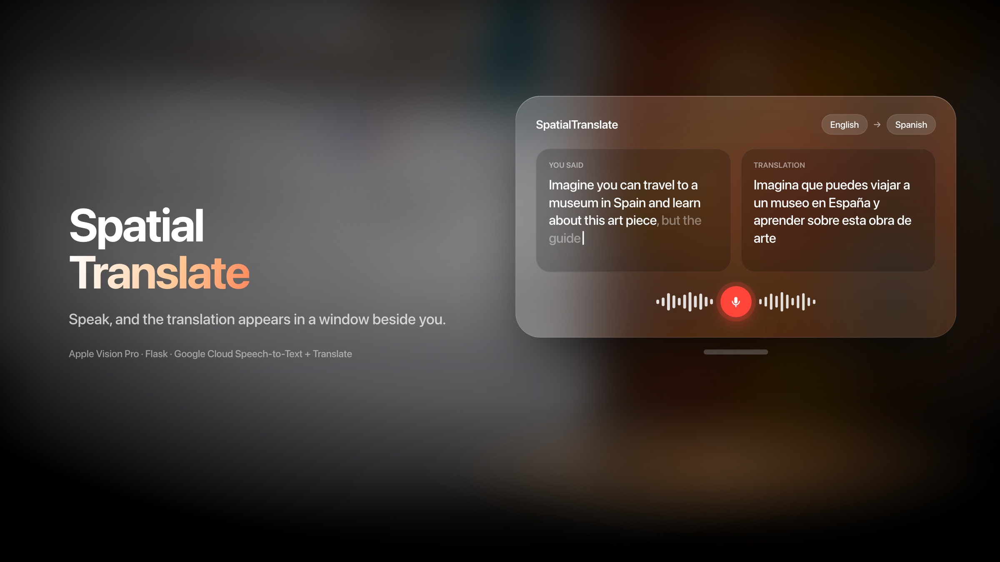
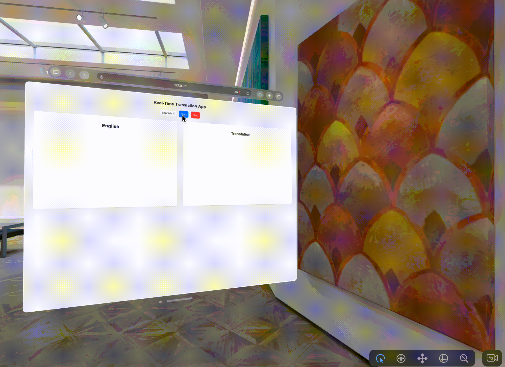

# SpatialTranslate

Live speech translation for Apple Vision Pro. Speak English, and the translation appears in a window beside you as you talk.



I built this in May 2024 after a Vision Pro residency at Founders, Inc. The idea: you're touring a museum in Spain, your guide doesn't speak English, and you want to understand the piece in front of you without looking down at a phone.

## In the simulator

The app running in Safari in the visionOS simulator, translating English to Spanish:



## How it works

```
Mac microphone ──► Flask + Socket.IO server ──► Google Cloud Speech-to-Text (streaming)
                                                         │ final transcript
                                                         ▼
Vision Pro window ◄── Socket.IO ◄──────────── Google Cloud Translation
(English | Translation)
```

- **Speech-to-text:** the server streams 16 kHz microphone audio to Google Cloud Speech-to-Text with interim results turned on.
- **Translation:** each finished sentence goes to Google Cloud Translation.
- **Display:** the original and the translation are pushed to the page over Socket.IO, side by side.
- **Languages:** English speech, translated to Spanish, French, German or Chinese.

The interface is a web page, so it runs in Safari on Vision Pro (or in the visionOS simulator) with nothing to install on the headset.

## Run it

You need Python 3, a Google Cloud project with the **Speech-to-Text** and **Cloud Translation** APIs turned on, and the [gcloud CLI](https://cloud.google.com/sdk/docs/install).

```sh
# PyAudio needs PortAudio
brew install portaudio

python3 -m venv venv
source venv/bin/activate
pip install -r requirements.txt

# Sign in so the Google Cloud client libraries can find your credentials
gcloud auth application-default login

python app2.py
```

Then open http://127.0.0.1:5000 in Safari in the visionOS simulator, pick a language, and press **Start**.

## Limitations

- **Audio comes from the Mac running the server, not the headset.** The server records with PyAudio, which works in the simulator but not on a Vision Pro on its own.
- Only finished sentences are translated, so the translation lags slightly behind your speech.
- This is a prototype: one speaker, one language pair at a time, no saved history.

## Related

- [Building a Translator App for Apple Vision Pro](https://medium.com/@piram.singh/building-a-translator-app-for-apple-vision-pro-cd4482e143a7): the full write-up.
- I also prototyped an on-device version with Whisper (via WhisperKit) to compare cloud and local speech recognition. Later, at Cornell Tech, I measured that same speed-versus-quality trade-off on a social robot in [Seeing vs. Responding](https://piramsingh.netlify.app/research.html).

---

Built by [Piram Singh](https://piramsingh.netlify.app).
